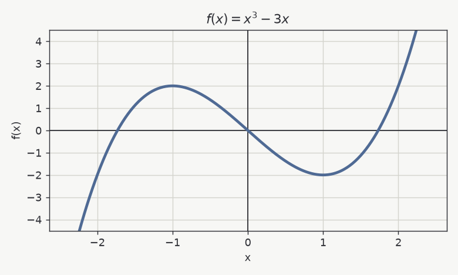

# Limits and continuity

Work through these first. Use the **Check** button to see feedback after each question.

## What is $\lim_{x \to 0} \dfrac{\sin x}{x}$? {tags=limits}

- [ ] $0$
- [x] $1$
- [ ] $\dfrac{1}{2}$
- [ ] $\infty$

> [!hint]
> This is a standard limit; think about the small-angle approximation $\sin x \approx x$.

> [!explanation]
> For small $x$ the sine is almost equal to $x$, so the ratio tends to $1$. The same result follows from the squeeze theorem or from L'Hôpital's rule.

## Which of these functions are continuous at $x = 0$? {type=multi points=2 tags=continuity}

- [x] $f(x) = x^2$
- [x] $f(x) = |x|$
- [ ] $f(x) = \dfrac{1}{x}$
- [x] $f(x) = \sin x$
- [ ] $f(x) = \lfloor x \rfloor$

> [!explanation]
> Polynomials, the absolute value and the sine are continuous everywhere. $\frac{1}{x}$ is not even defined at $0$. The floor function jumps at every integer: the left limit at $0$ is $-1$ while $\lfloor 0 \rfloor = 0$.

## Every differentiable function is continuous. {type=truefalse tags=continuity}

```answer
value: true
```

> [!explanation]
> If $f'(a)$ exists then $f(x) - f(a) = \frac{f(x) - f(a)}{x - a}\,(x - a) \to f'(a) \cdot 0 = 0$, so $f$ is continuous at $a$. The converse is false: $|x|$ is continuous but not differentiable at $0$.

# Derivative rules

## What is $\dfrac{d}{dx}\left(x^3 \sin x\right)$? {tags=derivatives}

- [ ] $3x^2 \cos x$
- [x] $3x^2 \sin x + x^3 \cos x$
- [ ] $3x^2 \sin x - x^3 \cos x$
- [ ] $x^3 \cos x$

> [!explanation]
> Product rule: $(uv)' = u'v + uv'$ with $u = x^3$ and $v = \sin x$.

## Let $f(x) = (2x + 1)^3$. Evaluate $f'(1)$. {type=numeric tags=derivatives}

```answer
value: 54
```

> [!hint]
> Use the chain rule: the outer function is the cube, the inner function is $2x + 1$.

> [!explanation]
> $f'(x) = 3(2x + 1)^2 \cdot 2 = 6(2x + 1)^2$, so $f'(1) = 6 \cdot 3^2 = 54$.

## Complete the rules. {type=blanks points=3 tags=derivatives}

The derivative of $\sin x$ is [[cos x|cos(x)]]. The derivative of $e^{x}$ is [[e^x|exp(x)]]. The derivative of $\ln x$ is [[1/x|x^-1|x^(-1)]].

> [!explanation]
> These three derivatives are the building blocks for most of the differentiation you will do. Answers such as `cos(x)` and `exp(x)` are accepted too.

## Which rule differentiates a composition of functions such as $\sin(x^2)$? {type=short tags=derivatives}

```answer
accept: ["chain rule", "the chain rule"]
```

> [!explanation]
> The chain rule: $\frac{d}{dx} f(g(x)) = f'(g(x))\, g'(x)$.

## Graph analysis of $f(x) = x^3 - 3x$ {type=fields points=4 tags=derivatives}



Use calculus, not just the picture.

```answer
fields:
  - label: "$f'(x)$ ="
    accept: ["3x^2-3", "3x^2 - 3", "3(x^2-1)", "3*(x^2-1)"]
    patterns: ['3\s*\*?\s*x\^2\s*-\s*3', '3\s*\*?\s*\(\s*x\^2\s*-\s*1\s*\)']
  - label: "Number of critical points"
    value: 2
  - label: "Local maximum at $x$ ="
    value: -1
  - label: "Local minimum at $x$ ="
    value: 1
```

> [!explanation]
> $f'(x) = 3x^2 - 3 = 3(x - 1)(x + 1)$ vanishes at $x = \pm 1$. Since $f''(x) = 6x$, we get $f''(-1) = -6 < 0$ (local maximum) and $f''(1) = 6 > 0$ (local minimum).

# Applications and integrals

## A circle's radius grows at $2$ cm/s. How fast is its area changing when $r = 5$ cm? {tags=applications}

- [ ] $10\pi\ \text{cm}^2/\text{s}$
- [x] $20\pi\ \text{cm}^2/\text{s}$
- [ ] $50\pi\ \text{cm}^2/\text{s}$
- [ ] $4\pi\ \text{cm}^2/\text{s}$

> [!explanation]
> $A = \pi r^2$, so $\frac{dA}{dt} = 2\pi r \frac{dr}{dt} = 2\pi \cdot 5 \cdot 2 = 20\pi$.

## If $F(x) = \displaystyle\int_0^x t^2\,dt$, what is $F'(x)$? {tags=ftc}

- [x] $x^2$
- [ ] $\dfrac{x^3}{3}$
- [ ] $2x$
- [ ] $x^3$

> [!explanation]
> The fundamental theorem of calculus: the derivative of $\int_a^x g(t)\,dt$ is $g(x)$. Here that is $x^2$. The expression $\frac{x^3}{3}$ is $F(x)$ itself, not its derivative.

## Evaluate $\displaystyle\int_0^1 x^2\,dx$. {type=numeric tags=integrals}

```answer
value: 0.3333
tolerance: 0.001
```

> [!hint]
> A fraction such as `1/3` is accepted as well as a decimal.

> [!explanation]
> $\int_0^1 x^2\,dx = \left[\frac{x^3}{3}\right]_0^1 = \frac{1}{3} \approx 0.3333$.

## Explain the Mean Value Theorem in your own words. {type=essay points=5 tags=theory}

State the hypotheses, say what the theorem concludes, and give a geometric or physical interpretation.

```answer
min_words: 60
max_words: 0
rubric:
  - Hypotheses: continuous on the closed interval and differentiable on the open interval
  - Conclusion: some point where the derivative equals the average rate of change
  - Interpretation: a tangent parallel to the secant line, or an instantaneous speed equal to the average speed
  - Clarity of the explanation
```
