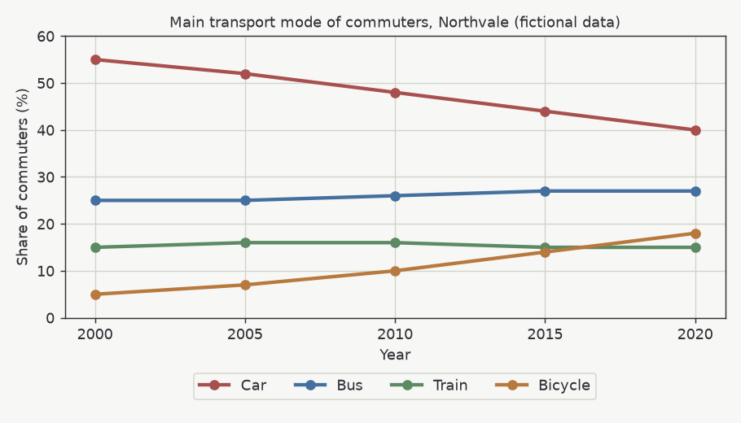

# Task 1 {time=20m}

You should spend about 20 minutes on this task.

## Summarise the information in the chart by selecting and reporting the main features, and make comparisons where relevant. {type=essay points=10 tags=task1}



The chart shows invented data for a fictional city. Write at least 150 words.

```answer
min_words: 150
max_words: 0
scoring: band
rubric:
  - Task achievement: reports the main trends accurately, picks out key features and gives a clear overview
  - Coherence and cohesion: ideas follow a logical order in paragraphs and are linked smoothly
  - Lexical resource: uses varied, precise vocabulary suited to describing data
  - Grammatical range and accuracy: mixes simple and complex sentences with few errors
```

# Task 2 {time=40m}

You should spend about 40 minutes on this task. Task 2 counts twice as much as Task 1.

## Some people think that cities should spend more money on cycling routes than on roads for cars. To what extent do you agree or disagree? {type=essay points=20 tags=task2}

Give reasons for your answer and include relevant examples from your own knowledge or experience. Write at least 250 words.

```answer
min_words: 250
max_words: 0
scoring: band
rubric:
  - Task response: answers every part of the question with a clear position that is developed and supported
  - Coherence and cohesion: a clear progression of ideas, sensible paragraphing and varied linking
  - Lexical resource: a wide range of vocabulary used accurately and naturally
  - Grammatical range and accuracy: a good range of structures with errors that rarely get in the way
```
