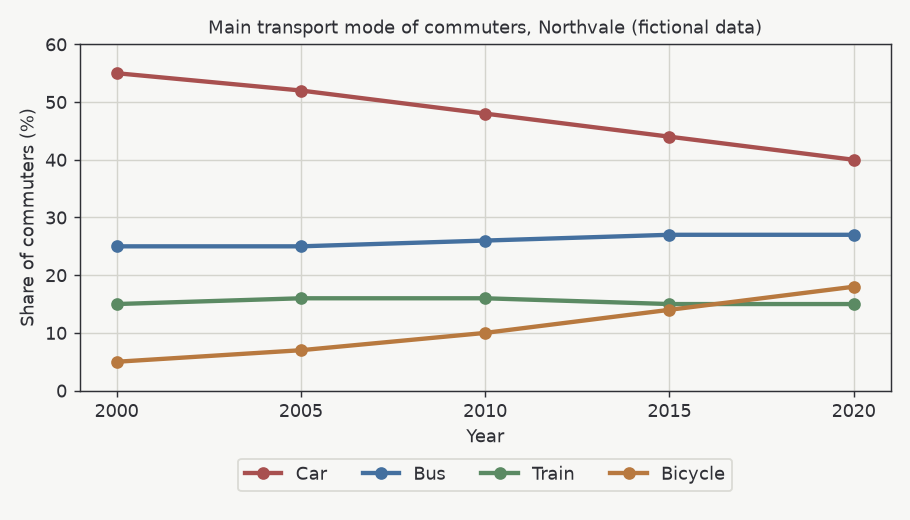

# Task 1 {id=task-1 time=20m}

You should spend about 20 minutes on this task.

## Summarise the information in the chart by selecting and reporting the main features, and make comparisons where relevant. {type=essay points=10 tags=task1 id=chart-summary}



The chart shows invented data for a fictional city. Write at least 150 words.

```answer
min_words: 150
max_words: 0
rubric:
  preset: ielts-writing-task1
```

# Task 2 {id=task-2 time=40m}

You should spend about 40 minutes on this task. Task 2 counts twice as much as Task 1.

## Some people think that cities should spend more money on cycling routes than on roads for cars. To what extent do you agree or disagree? {type=essay points=20 tags=task2 id=cycling-routes}

Give reasons for your answer and include relevant examples from your own knowledge or experience. Write at least 250 words.

```answer
min_words: 250
max_words: 0
rubric:
  preset: ielts-writing-task2
```
